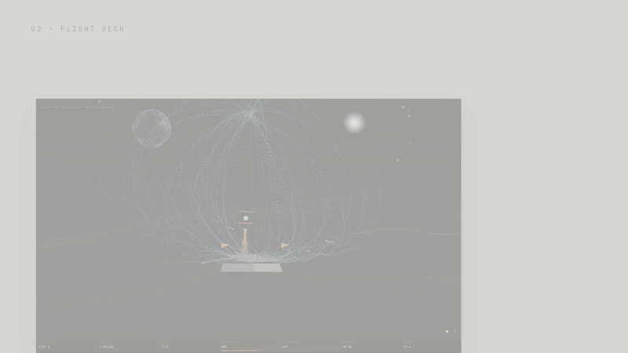
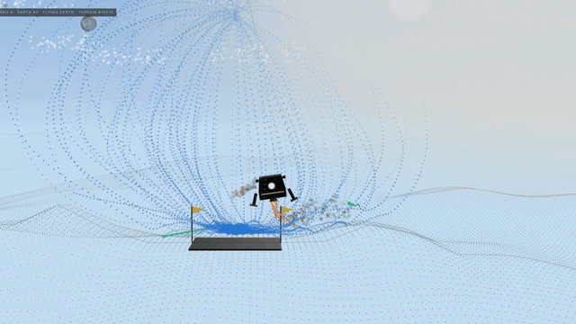
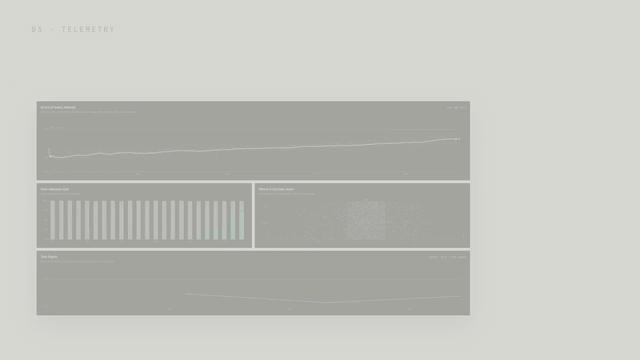
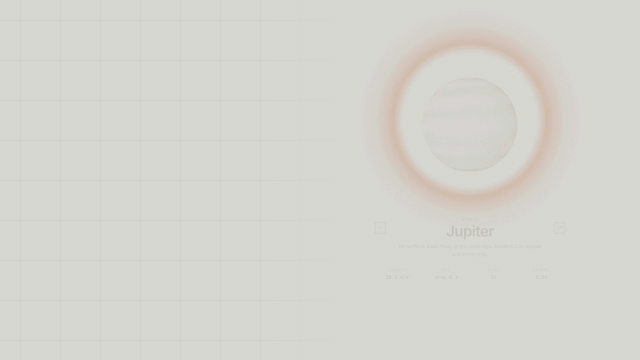
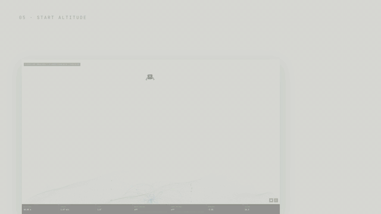
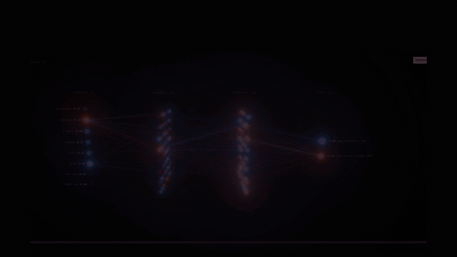
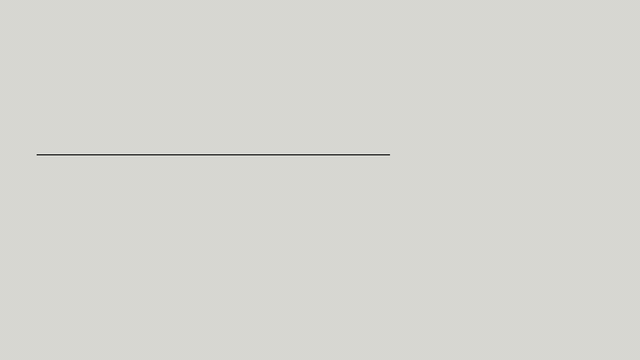
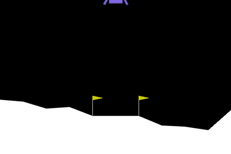
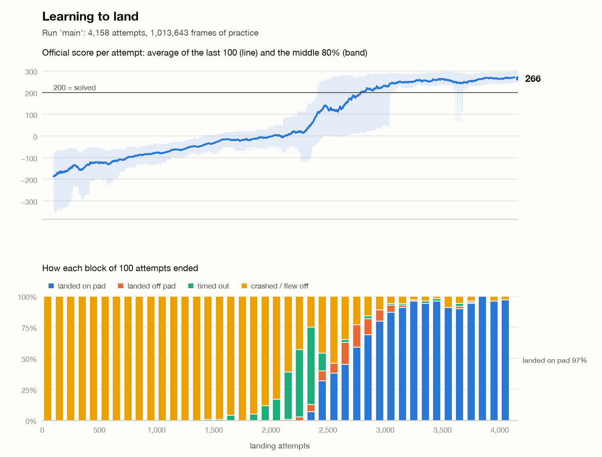

<div align="center">

# PerfectLand

**Teach a neural network to land a rocket on 13 worlds, and watch it learn.**

<sub>Gymnasium · Stable-Baselines3 (PPO) · PyTorch · three.js · runs on a laptop</sub>

</div>

<br>

<a href="media/perfectland-tour.mp4?raw=true"></a>

<p align="center"><sub>▶ <a href="media/perfectland-tour.mp4?raw=true"><b>Download the 23-second tour</b></a> (MP4, 6.6 MB, with sound). Every shot is the real app, recorded while it ran.</sub></p>

A neural network learns to land a rocket in the Lunar Lander physics simulator, using
reinforcement learning and **reward shaping**. Nobody tells it how to fly: every frame,
the reward function in [`reward.py`](reward.py) turns what just happened into points,
and the network practices until it finds the flying style that earns the most. Training
takes about 80 seconds on the Apple M5 laptop this was built on, and a local web app
lets you train it, fly it on other worlds and look inside its brain.

| Pilot | Landed on the pad (100 new flights) | Average score |
|---|---|---|
| Random button presses | 0% (89% crash, 10% fly off screen) | −201 |
| Trained for 1 million frames | **100%** | **256** (200 = solved) |

## Highlights

<table>
  <tr>
    <td width="50%" valign="top">
      
      <br><b>Attempt 1: random buttons.</b>
      <br><sub>An untrained network on Earth. Nobody tells it how to fly, so it crashes.</sub>
    </td>
    <td width="50%" valign="top">
      
      <br><b>Every attempt, charted.</b>
      <br><sub>A fresh pilot went from 0% to 95% landed in 3,960 attempts, about 80 s of training.</sub>
    </td>
  </tr>
  <tr>
    <td width="50%" valign="top">
      
      <br><b>13 worlds, real gravity.</b>
      <br><sub>From Pluto's 0.7 m/s² to Jupiter's 23.1, each with its own sky, air and wind.</sub>
    </td>
    <td width="50%" valign="top">
      
      <br><b>Start from up to 40 m.</b>
      <br><sub>Higher starts get more time on the clock, and pilots trained there touch down about 3× softer.</sub>
    </td>
  </tr>
  <tr>
    <td width="50%" valign="top">
      
      <br><b>Inside the pilot's brain.</b>
      <br><sub>Every connection glows with the signal it carries on this frame. Click any neuron.</sub>
    </td>
    <td width="50%" valign="top">
      
      <br><b>Train each world its own way.</b>
      <br><sub>Pick the world, the start altitude and how long; each world keeps its own line of generations.</sub>
    </td>
  </tr>
</table>

## Quick start

You need Python 3.10 to 3.13. (3.14 also works, but then Box2D compiles from source
and needs a C++ compiler.) Check with `python3 --version` first: the `python3` that
ships with macOS can be 3.9, which is too old. In that case install a newer one (for
example `brew install python@3.12`) and use `python3.12` in the first command below.

```bash
python3 -m venv .venv
source .venv/bin/activate          # Windows: .venv\Scripts\activate
pip install -r requirements.txt

python train.py                    # practice for 1 million frames
python watch.py                    # watch 3 landings in a window
python evaluate.py                 # score the pilot on 100 new flights
python evaluate.py --random        # compare with random button presses
python watch.py --gif flight.gif   # save landings as a GIF instead
```

What `watch.py` shows, before and after training:

| Before training: random buttons | After 1 million frames of practice |
|---|---|
|  |  |

## Mission control: the web UI

```bash
python app.py                      # opens http://localhost:8000
```

A local web app for training, flying and inspecting pilots on 13 worlds. It needs no
extra Python packages. The page loads three.js (3D graphics) and its fonts from a CDN,
so keep an internet connection.

### Worlds

| World | Gravity (m/s²) | Air and wind | Engine |
|---|---|---|---|
| Classic | 10 | none (the original Lunar Lander) | 1× |
| Mercury | 3.7 | none | 0.37× |
| Venus | 8.9 | very thick air, light wind | 1× |
| Earth | 9.8 | thin air, breeze | 1× |
| Moon | 1.6 | none | 0.34× |
| Mars | 3.7 | very thin air, dusty gusts | 0.37× |
| Jupiter | 23.1 | pad floats in the cloud tops; strong wind | 2.3× |
| Europa | 1.31 | none | 0.34× |
| Saturn | 9.0 | pad floats above the clouds; strong wind | 1× |
| Titan | 1.35 | thick air, light wind | 0.34× |
| Uranus | 8.7 | strong wind | 1× |
| Neptune | 11.0 | the strongest wind | 1.1× |
| Pluto | 0.7 | none | 0.34× |

Gravity is real (NASA's Planetary Fact Sheet; Titan's and Europa's come from their mass
and radius). Air drag, wind and turbulence are simplified to fit the simulator. Two
things had to change to make other worlds landable:

- **Engines sized like a real lander's.** The standard engine pushes 17.8 m/s². That
  can't even hover on Jupiter, and on the Moon it is 11 times gravity, so every burn is
  a violent kick. Each world's engine is about 1.8 times its gravity, and at least
  6 m/s² so it can still cancel the random push every flight starts with.
- **Landing legs rated for the world.** The simulator's leg springs are sized for
  10 m/s². On Jupiter they folded under the rocket's own weight, so even a perfect
  touchdown scraped the hull and counted as a crash. Above 10 m/s² the springs now get
  stronger with gravity.

Picking a world restyles everything: the dotted globe in the hero, and the flight
deck's sky, ground, weather and neighbors (Earth hangs over the Moon, Jupiter over
Europa, Saturn behind Titan's haze).

Here is a pilot trained only on Classic for 1 million frames, flown on every world with
no extra training (20 test flights each, new terrain):

| Lands easily (18–20 of 20) | Struggles |
|---|---|
| Classic 20, Earth 20, Mercury 19, Venus 19, Mars 19, Saturn 19, Uranus 19, Jupiter 18 | Neptune 12 (wind), Titan 9, Moon 8, Europa 8, Pluto 3 |

On the low-gravity worlds it floats, drifts and often leaves the screen. That is what
per-world training is for.

### The page

- **Worlds:** the selected world as a rotating dotted globe, with its facts. Arrows or
  the chips in the flight deck switch worlds.
- **Flight deck:** the 3D replay on the selected world. The HUD shows altitude, speed,
  tilt, main and side engine power, and how your reward function scored the frame. The
  flight trace below charts altitude, speed and engine power over the whole flight;
  click it to jump to a moment. The console sets the conditions, including the
  **start altitude**, and has **Launch flight**, **Run 20 test flights**, **Tour every
  world** (20 test flights on each) and **Train on this world**. While a pilot trains, its newest test flight plays here, and
  recent practice attempts appear as dotted trails.
- **Practice · Score · Learn:** three live cards: recent practice paths, the reward
  "potential" field with the rocket on it, and the hidden neurons firing.
- **Telemetry:** every practice attempt as a dot, how attempts end, where each one
  touches down, and test-flight scores, filterable by world. All update live.
- **Neurons:** the network in 3D. The glow on each connection is the signal flowing
  through it on the current frame. Click a neuron to see what it listens to and how it
  fires over the flight, or switch on **What if** to set the 8 sensor readings yourself
  and watch the decision change. **Brain health** counts neurons that are active, quiet
  (barely move) or saturated (stuck at their limit).
- **Generations:** every training run, filterable by world, with where it started from.
  Delete a generation from its row, a whole world's line, or every generation at once
  (see [Deleting generations](#deleting-generations)).

### Training: pick the world and how long

Every training run starts by asking four things:

- **World:** where to practice. The chips show how many generations the pilot already
  has on each world.
- **Start altitude:** how high above the pad each practice flight starts (see below).
- **Duration:** Quick (250k frames) to Extra long (5M), with time estimates based on
  your computer's measured training speed.
- **Start from:** each world has its own line of generations. Training on Mars continues
  the pilot's latest Mars generation (Mars #1, Mars #2, …). The first time a pilot
  trains on a world, it can bring another world's skills over (start from that world's
  latest generation) or begin with a blank network.

The world's physics, the reward weights and the learning settings sit in fold-out
sections below, each knob with a one-line explanation. **Keep retraining automatically**
chains generations on the same world until you press Stop. In the flight deck, each
world is flown by its own specialist (its latest generation), or by the newest
generation if the pilot hasn't trained there yet.

### Buttons or throttle

A new pilot can use **buttons** (each engine fully on or off) or a **throttle**: the
network outputs two numbers every frame, and the simulator turns them into main-engine
power (50–100% when it fires) and side-engine power. The pilot learns how much power to
use where. Three throttle pilots trained on Classic for 1.3 million frames each landed
20 of 20 test flights with scores of 282–286, against about 260–275 for button pilots,
because they spend less fuel. A typical throttle flight keeps the main engine on for
most of the descent at only 50–70% power: gentle, continuous burns instead of full-power
pulses. The HUD, flight trace, decision panel and 3D brain all show the throttle values.

### Start altitude: more room to land

The simulator always drops the rocket 10 m above the pad. **Start altitude**, in the
flight deck console and in every training run, moves the start anywhere from 5 to 40 m,
on any world. It belongs to the flight, not the world: Mars from 30 m is still in Mars's
line of generations, and the Generations table notes it under Settings.

- **How it works.** `StartHeight` in [`lander.py`](lander.py) lets the simulator build each
  flight as usual (terrain, random push), then lifts the rocket and its legs and runs one
  frame with the engines off, so the pilot's readings and the score start from there.
  Flights from 10 m are exactly as before.
- **More time on the clock.** A flight times out after 20 s from 10 m. Falling 4 times as
  far takes twice as long, so the limit grows with the square root of the height: 28 s
  from 20 m, 35 s from 30 m, 40 s from 40 m.
- **Scores grow with height.** The official score counts progress toward the pad, so a
  landing from 30 m scores about 560 instead of about 280, and "200 = solved" only means
  something from 10 m. Compare generations by landings and precision instead.
- **Precision.** Test flights now measure how far from the pad center each landing stopped
  and how fast the legs touched down. You'll find both in the console after **Run 20 test
  flights**, in the flight log, and in the Generations table's Precision column.

Does starting higher make better pilots? I trained button pilots on Classic for 2 million
frames from 10 m (2 training seeds) and from 30 m (3 seeds), then flew each 100 times from
every height:

| Trained from | Landed from 10 m | 20 m | 30 m | 40 m | Touchdown speed | Distance from center |
|---|---|---|---|---|---|---|
| 10 m | 98–99% | 97–100% | 87–90% | 78–79% | 2.2–2.5 m/s | 0.2–0.4 m |
| 30 m | 97–100% | 100% | 100% | 100% | 0.6–1.2 m/s | 0.3–0.4 m |

- **Softer, not closer.** Pilots trained from 30 m touch down about three times as softly
  and land from every height, even 40 m, which they never practiced. They stop no closer
  to the center. Pilots trained from 10 m learn to drop the last stretch: with more
  practice their touchdowns got harder (about 1 m/s after 1M frames, 2.4 m/s after 2M),
  since the landing still counts and coming in fast saves fuel and time.
- **A blank network needs longer from high up.** In 3 of the 4 runs from 30 m, test
  flights that had already been landing went through a stretch (somewhere between 0.8M
  and 1.2M frames) where every one hovered a few centimeters above the pad until time ran
  out, while practice flights still landed. Near the ground the network was nearly
  undecided between its four buttons (about 20–33% each). Test flights always take its
  top choice, which kept an engine firing; practice flights pick by those odds, so sooner
  or later they let it settle. The likely reason it takes longer: from 30 m, the last
  meter is a smaller share of every practice flight, so the network gets fewer chances
  to sharpen that decision. Every run got past it by about 1.3M frames, so train blank
  networks from high up for 2M frames (Long). Flights and tests in the deck use each
  generation's best-scoring network, so a run that ends mid-hover still flies well.
- **Low gravity cuts the other way.** On the Moon, extra height mostly means more time
  for the random push to carry the rocket sideways. Two Moon pilots, each continued from
  the same Classic pilot for 1M frames: the one trained from 10 m landed 63 of 100 flights
  from 10 m; the one trained from 30 m landed 49 of 100 from 30 m, and 38 drifted off
  screen.

### Deleting generations

The Generations table can remove runs you don't want. Each takes a second click to
confirm, and none works while that pilot is training:

- **Delete** on a row removes that generation: its networks, practice attempts, test
  flights and trails. Generations trained after it keep their own networks and still
  fly; their "Started from" says the parent was deleted.
- **Delete the Mars line** (it appears when you filter the table to a world) removes
  every generation trained on that world. The pilot's other worlds stay.
- **Start over** removes every generation but keeps the pilot's name. Its next training
  starts again at gen 1 from a blank network, and you can pick buttons or throttle and
  the network size again.
- **Delete the pilot** removes it and everything it learned from the pilot list.

Nothing is destroyed: deleted generations move to `runs/.trash/<pilot>/` (a deleted
pilot to `runs/.trash/`), with the networks and the removed rows of `episodes.csv` and
`tests.csv`, so you can put them back by hand. Empty `runs/.trash/` when you're sure.

### Where it saves things

Each pilot lives in `runs/<pilot>/`: `lab.json` (its generations and their settings),
`episodes.csv` (every practice attempt), `tests.csv`, `trails.json`, and a `gen-N/`
folder of saved networks per generation. Runs made with `train.py` are imported the
first time `app.py` starts (it flies 20 test flights to fill in the scoreboard). If you
train with `train.py` while `app.py` is running, restart `app.py`. `train.py` won't
overwrite a pilot that mission control has trained; give it another `--run` name.

## The four pieces

**1. The simulator.** [Gymnasium](https://gymnasium.farama.org)'s `LunarLander-v3`, a 2D
physics world (Box2D) with gravity, a main engine and two side engines. Lunar Lander
first shipped with OpenAI Gym; the Farama Foundation maintains it today. Each frame (50
per second) the rocket reports 8 numbers, and the pilot presses one of 4 buttons:

| The pilot sees | The pilot can press |
|---|---|
| position x, y (relative to the pad) | nothing |
| velocity vx, vy | left engine |
| tilt and spin | main engine |
| whether each leg touches the ground | right engine |

A flight ends when the rocket comes to rest (landed), its hull touches the ground
(crashed), it leaves the screen, or 1,000 frames pass (timed out).

**2. The brain.** A neural network with 8 inputs, two layers of 64 neurons, and 4
outputs: a probability for each button. A second network of the same shape, the
*critic*, learns to predict how many points are coming. That's 9,797 adjustable numbers,
created in one line by [Stable-Baselines3](https://stable-baselines3.readthedocs.io).

**3. The reward function.** [`reward.py`](reward.py), the only place you say what you
want. See the next section.

**4. The training.** PPO (Proximal Policy Optimization). Sixteen simulators fly at once.
Every 16,384 frames, PPO goes through every button press and asks: did more points
follow than the critic predicted? It makes the better-than-expected presses more likely
and the rest less likely, in small capped steps (the "proximal" part), then flies
again. One million frames is about 60 of these rounds, or about 4,000 landing attempts.

## Reward shaping, the key idea

Suppose you only said "+100 for landing, −100 for crashing." A random pilot almost never
lands (0 times in 100 flights), so it never sees the +100 and has no way to learn that
landing is even possible. The reward is too *sparse*.

Reward shaping adds small, frequent rewards that point toward the goal. Here's the
heart of `reward.py`:

```python
def potential(obs):
    """How good is this moment? Closer, slower, upright, legs down = higher."""
    x, y, vx, vy, angle, _spin, left_leg, right_leg = obs
    return (
        -DISTANCE_WEIGHT * np.hypot(x, y)
        - SPEED_WEIGHT * np.hypot(vx, vy)
        - TILT_WEIGHT * abs(angle)
        + LEG_CONTACT_BONUS * (left_leg + right_leg)
    )

reward = potential(obs) - potential(prev_obs)   # every frame
```

The rocket earns points for *progress*: getting closer to the pad, slowing down,
straightening up, putting its legs down. If it moves back the other way, it loses
exactly the points it gained. Over a whole flight, the progress points add up to "where it
ended" minus "where it started," so hovering near the pad can't farm them. This is
called potential-based reward shaping (Ng, Harada & Russell, 1999). It's a standard
technique because it guides learning while rewarding nothing except real progress.

The full scorecard:

| What happens | When | Points |
|---|---|---|
| Gets closer to the pad, slows down, or straightens up | every frame | 100 × the improvement (minus the same for getting worse) |
| A leg touches the ground | every frame | +10 per leg (−10 if it lifts off again) |
| Main engine fires | every frame | −0.3 × its power, for fuel |
| Side engine fires | every frame | −0.03 × its power, for fuel |
| Time passes | every frame | −0.05 (added by this project) |
| An engine fires while parked (both legs down, nearly stopped) | every frame | −0.3 (added by this project) |
| Comes to rest on its legs | once, at the end | +100 |
| Hull hits the ground, or flies off screen | once, at the end | −100 |

Every row not marked "added" is Lunar Lander's built-in reward. With the two additions
set to zero, `reward.py` reproduces the built-in reward to within 0.0001 points per
frame. Training logs and `evaluate.py` always report the official built-in score, so
your results stay comparable with everyone else's (200+ = solved) however you change
the reward.

## A real reward bug, found while building this

The first version of `reward.py` had no ground-engine cost. Its pilot aced the test
flights (99 of 100 on the pad), but during practice 83% of attempts timed out.

The cause: the rocket touched down on the pad and then kept tapping its side engines,
about one frame in three. A side engine costs only 0.03 points, so nothing
discouraged it. But the simulator only counts a landing once the rocket has been
almost perfectly still for half a second, so the +100 never arrived. A pilot that has
never collected that bonus has no reason to keep still.

One new line fixed it: −0.3 for firing any engine while parked (both legs down and
almost stopped). With the same random seed, practice landings at 1 million frames went
from 4% to 95%. Touching down stays free, so the pilot can still brake all the way to
the ground.

That's reward shaping in practice: watch what the agent actually does, find the
incentive that explains it, change the reward, retrain.

### A second one: the pilot that crashed on purpose

Throttle pilots (see mission control) brought a new surprise. They learned to land
cleanly in test flights, then got worse with more practice, until every test flight
ended with the hull slammed into the pad: a deliberate crash.

A throttle pilot explores by adding random noise to every engine setting, and that
noise doesn't switch off on the ground. Parked on the pad, it kept nudging the engines,
paid the parking cost again and again, and never came to rest, so the +100 never came.
For the rest of the episode that added up to more than the −100 crash penalty. The
cheapest way out the pilot could find was to end the flight by crashing.

Raising the penalty would only have moved the problem around. The fix is a rule real
landers use: the Apollo lunar module cut its engine on "contact light". For throttle
pilots, the engines now shut off automatically once the rocket is parked
(`TouchdownCutoff` in `lander.py`). It doesn't help them land; it only stops the noise
once they have. Three throttle pilots then landed 20 of 20 test flights each, and
practice landings rose from about 0% to over 90%.

## Reading the training output

```
                        practice: last 100 attempts     test: 20 flights
    frames  attempts    score  on pad  crashed  timeout     score  on pad
   114,688     1,198    -63.0      0%     100%       0%     -98.4    0/20  best
   311,296     2,169      9.1      0%      67%      33%    -130.3    0/20
   507,904     2,455    128.8     27%      28%      38%     227.9   20/20  best
   704,512     3,102    245.7     87%       6%       1%     213.3   19/20
 1,015,808     4,158    265.9     97%       3%       0%     257.5   20/20  best
```

During **practice** the agent picks buttons at random according to its probabilities
(say 90% nothing, 10% side engine), so it keeps trying new things. **Test** flights
always press the most likely button, which shows what it has actually learned. Every
time the test score beats the previous best, that pilot is saved as
`runs/main/best_model.zip`.

Training ends with a learning curve (`runs/main/learning_curve.png`). Here's the one
from this run. First it learns to crash more gently. Then it learns to touch down but
not to settle, so those flights time out. Finally it learns to switch off and land:



## Experiments: break the reward on purpose

Each row below is one change to `reward.py`, trained for 1 million frames with the same
seed:

| Change in `reward.py` | Practice landings on pad | Test flights landed | What the rocket learned |
|---|---|---|---|
| none (the default) | 95% | 20/20 | to land |
| `GROUND_ENGINE_COST = 0.0` | 4% (83% time out) | 19/20 | to land, then fidget on the pad |
| `DISTANCE_WEIGHT`, `SPEED_WEIGHT`, `TILT_WEIGHT`, `LEG_CONTACT_BONUS` all `0.0` (no shaping) | 0% | 0/20 | engines off, free-fall into the ground |
| `reward = potential(obs)` (the state, not the change) | 0% | 0/20 | to crash as fast as possible |

- **No shaping:** the pilot never stumbles onto a landing, so the best outcome it knows
  is the cheapest crash: no fuel spent and no time wasted.
- **The state instead of the change:** the potential is negative while flying (far
  away, moving fast), so every frame in the air costs points. The quickest way to stop
  losing points is to hit the ground. Reward progress, not position.

To run one yourself, edit `reward.py`, then train under a new name so the main pilot
stays intact:

```bash
python train.py --run no-shaping
python watch.py --run no-shaping
```

Each run keeps a copy of the `reward.py` that trained it in `runs/<name>/reward.py`.
Copy `runs/main/reward.py` back over `reward.py` to undo your edits.

More ideas to try (these haven't been measured):

- **Wind:** in `lander.py`, change the `gym.make(...)` call to
  `gym.make(ENV_ID, render_mode=render_mode, enable_wind=True, wind_power=15.0)`.
- **Expensive fuel:** multiply `MAIN_ENGINE_COST` by 10 and watch the landing style change.
- **Precision:** pay the landing bonus only between the flags (the outcome is
  `"landed on pad"`).
- **More practice:** `python train.py --steps 3000000`.

## Files

| File | What it does |
|---|---|
| [`reward.py`](reward.py) | The reward function. The file you're meant to edit. |
| [`lander.py`](lander.py) | Plugs the reward into the simulator, adds other worlds' physics and start altitudes, labels how each flight ended (and how precisely it landed), and flies a pilot. |
| [`train.py`](train.py) | Trains a pilot with PPO and saves it in `runs/<name>/`. |
| [`watch.py`](watch.py) | Watches a pilot in a window or saves a GIF (`--random` for an untrained one). |
| [`evaluate.py`](evaluate.py) | Scores a pilot on 100 flights. |
| [`plot.py`](plot.py) | Redraws a run's learning curve, even while it's still training. |
| [`app.py`](app.py) | The mission control web server: serves the UI and streams live training events. |
| [`lab.py`](lab.py) | The worlds, pilots and their generations, recorded flights, network weights, and the training process behind the UI. |
| [`ui/`](ui/) | The web page: [`stage.js`](ui/stage.js) (3D flights), [`worlds.js`](ui/worlds.js) (planet globes and looks), [`brain.js`](ui/brain.js) (3D network), [`charts.js`](ui/charts.js), [`nn.js`](ui/nn.js) (the network and reward, in JavaScript), [`app.js`](ui/app.js) (wiring). |
| [`media/`](media/) | The tour video and README GIFs, recorded from the running app, plus the `watch.py` GIFs. |

Each `runs/<name>/` folder made by `train.py` holds `best_model.zip`, `final_model.zip`,
the training logs, the learning curve, and the `reward.py` snapshot.

## Troubleshooting

- **Old tutorials use `import gym` and `LunarLander-v2`.** This project uses their
  successors, `import gymnasium` and `LunarLander-v3`.
- **Box2D won't install:** use Python 3.10 to 3.13, which get a prebuilt Box2D. On
  3.14 it compiles from source and needs a C++ compiler (`xcode-select --install` on macOS).
- **No window opens** (for example on a server): use `python watch.py --gif flight.gif`.
- **Port 8000 is taken:** `python app.py --port 9000`.
- **The mission control page is blank:** it loads three.js from cdn.jsdelivr.net, so
  check your internet connection.
- **Training is slow:** everything runs on the CPU, because a network this small trains
  fastest there. Time scales with your processor; `--envs` sets how many simulators fly
  at once.
- **Practice lands but every test flight times out:** the pilot is hovering just above
  the pad (see [Start altitude](#start-altitude-more-room-to-land)). Keep training, or
  continue from the generation's best test (**Which version** in the training panel).
